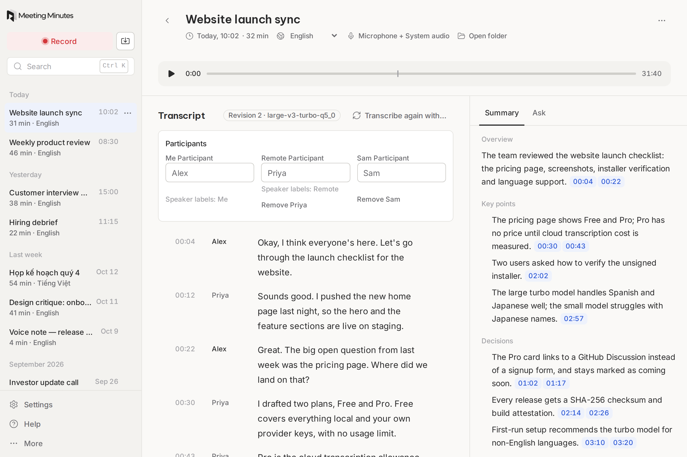
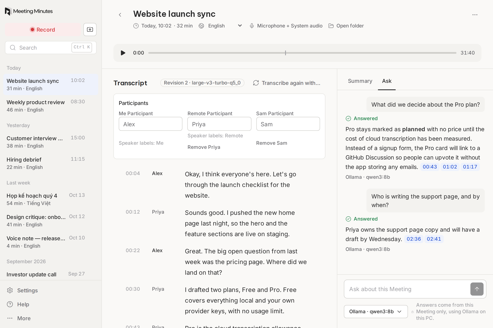

<p align="center">
  
</p>

<p align="center">
  <strong>Record any call on Windows. Get a transcript, a summary and cited answers, kept on your PC.</strong>
</p>

<p align="center">
  <a href="https://github.com/ducdv98/meeting-minutes/releases/latest"></a>
  <a href="LICENSE"></a>
  
  <a href="https://github.com/ducdv98/meeting-minutes/releases"></a>
</p>

<p align="center">
  <a href="https://meeting-minutes.tech">Website</a> ·
  <a href="https://github.com/ducdv98/meeting-minutes/releases/latest">Download</a> ·
  <a href="https://meeting-minutes.tech/privacy">Privacy</a> ·
  <a href="#project-structure">Project structure</a> ·
  <a href="CONTRIBUTING.md">Contribute</a>
</p>

<picture>
  <source media="(prefers-color-scheme: dark)" srcset="website/src/assets/screens/meeting-dark.png">
  
</picture>

Meeting Minutes records your calls on a Windows PC and turns them into Meetings in a personal Library. It captures your Microphone and your PC's System audio, so it works with any calling app, and it transcribes on your PC with Whisper by default. It is free.

**Status:** version 1.2.1. The optional Managed transcription service is experimental.

## How it works

1. **Record.** Start a Recording. Meeting Minutes captures the Microphone and System audio as separate Sources and writes the audio to disk in Chunks, so a crash doesn't lose the call.
2. **Transcribe.** Whisper runs locally by default, on your GPU when one is available. You can switch to your own Groq or Gemini key.
3. **Summarize.** Get a Summary with Action items for any Meeting.
4. **Ask.** Ask questions about one Meeting. Answers cite the parts of the Transcript they come from, and say so when the Transcript doesn't answer.

## Why Meeting Minutes?

- **Works with any calling app.** It records what your PC hears and plays, so there are no plugins or bots joining your call.
- **Local by default.** Transcription runs on your PC, and cloud services are opt-in, under your own keys.
- **Your Library is plain files.** Every Meeting is a readable folder of audio and transcript files in `Documents\Meeting Minutes`. The app can rebuild everything else from it.
- **Free and open source.** The app code is MIT-licensed, with no account and no telemetry.

## Features

- **Snapshots:** while a Recording runs, capture a region of your screen, such as a shared slide. It appears in the Transcript at that moment and stays on your PC.
- **Cited answers:** Summaries and Answers link back to the Transcript, so you can check them.
- **Search:** find words across every Transcript in your Library.
- **Record prompt:** when another app starts using the Microphone, you are offered a Recording. It never starts one by itself.
- **Source health:** a silent Microphone or System audio is flagged while you record, not after.
- **Import:** turn an existing audio file into a Meeting.
- **Voice notes:** record with the Microphone only.
- **Multilingual:** transcribe in many languages, with recommended models on first run.

<picture>
  <source media="(prefers-color-scheme: dark)" srcset="website/src/assets/screens/ask-dark.png">
  
</picture>

## Privacy: what leaves your PC

Your Library stays on your PC. This table shows what is sent, and when.

| Feature | Default | With a key you add |
|---|---|---|
| Transcription | Local Whisper. Audio stays on your PC. | Audio goes to Groq (`whisper-large-v3`), or to Gemini for fallback transcription. |
| Correction | Off | Gemini receives Transcript text. |
| Summary, Action items and Ask | Ollama on your PC | Gemini, OpenAI or Anthropic. The app asks before sending a Meeting. |
| Managed transcription | Off | Audio only, after you paste a Managed key. The service never holds your Library. |
| API keys | Windows Credential Manager | Same. |
| Telemetry | None | None |

Gemini's free tier may use content for training. Full details are in the [privacy policy](https://meeting-minutes.tech/privacy).

## Download

Download it from [meeting-minutes.tech](https://meeting-minutes.tech) or from the [GitHub Releases page](https://github.com/ducdv98/meeting-minutes/releases/latest). The app checks for updates when it starts and asks before installing one.

- **Supported:** Windows 11 x64. Windows 10 may work but is untested.
- **Known limitation, SmartScreen:** the installer is not code-signed, so Windows may say it protected your PC. Download it only from the links above, then choose **More info → Run anyway**. To check the download first, see [Verify the installer](https://meeting-minutes.tech/support/#smartscreen).
- **Not available:** macOS and Linux. The core and UI build and test on Linux, but capture needs Windows.

### Uninstall

Use **Settings → Apps → Installed apps** in Windows. Your Library in `Documents\Meeting Minutes` is always kept. Tick the box in the uninstaller if you also want to remove the app's data (downloaded models, settings, search index and log). API keys stay in Windows Credential Manager after uninstalling, so remove them in the app's **Settings** first.

## Support

Email [admin@meeting-minutes.tech](mailto:admin@meeting-minutes.tech) or open a [GitHub issue](https://github.com/ducdv98/meeting-minutes/issues). To include diagnostics, open **Help** in the app, choose **Copy diagnostics** and paste the text into your message. Diagnostics never include your Transcripts, Summaries or keys.

## Project structure

Meeting Minutes is a [Tauri v2](https://tauri.app) app: a Rust core behind a React UI, with [whisper.cpp](https://github.com/ggml-org/whisper.cpp) for transcription. The core owns everything that touches your data, and the UI calls into it.

```text
meeting-minutes/
├── crates/
│   ├── core/            Rust core: recording, Library, Transcripts, Summary, Ask, cloud clients
│   └── whisper/         whisper.cpp bindings and the transcription benchmark
├── src-tauri/           Tauri shell: windows, commands, capabilities, installer config
├── src/                 React UI: views, panels and the capture bar (Vitest tests sit beside the code)
├── website/             meeting-minutes.tech, a static site
├── scripts/             Release-version check, Vulkan loader copy, screenshot and benchmark tools
├── spikes/              Throwaway audio-capture experiments, kept for reference
├── docs/
│   ├── adr/             Architecture decision records: why things are the way they are
│   ├── research/        Platform research: audio capture, distribution, licences
│   └── releasing.md     Maintainer guides, with branding.md and design/
├── assets/brand/        Logo and wordmark (not MIT-licensed, see License)
├── .github/workflows/   CI, release and website deploy
└── CONTEXT.md           Domain vocabulary: Meeting, Library, Snapshot and so on
```

| I want to change… | Look in |
|---|---|
| How audio is captured or chunked | `crates/core/src/capture*`, `recorder.rs`, `recording.rs` |
| Transcription and models | `crates/whisper`, `crates/core/src/speech_models.rs`, `processing.rs` |
| Summary, Ask and Citations | `crates/core/src/summary.rs`, `ask.rs`, `citation.rs`, `ai/` |
| Cloud providers | `crates/core/src/cloud/` |
| The Library on disk | `crates/core/src/library.rs`, `meeting_file.rs`, `index.rs` |
| A screen in the app | `src/*View.tsx`, `src/*Panel.tsx` |
| The website | `website/src/` (see [`website/README.md`](website/README.md)) |
| Why a decision was made | `docs/adr/` |

Use the terms in [`CONTEXT.md`](CONTEXT.md) in code, UI text and docs.

## Documentation

| Document | What it covers |
|---|---|
| [`CONTEXT.md`](CONTEXT.md) | The domain vocabulary |
| [`docs/adr/`](docs/adr/) | Decisions, such as [local-first AI with explicit cloud use](docs/adr/0002-local-first-ai-with-explicit-cloud.md) |
| [`docs/research/`](docs/research) | Research behind capture, distribution and licences |
| [`docs/releasing.md`](docs/releasing.md) | How maintainers cut a release |
| [`docs/branding.md`](docs/branding.md) | Brand and artwork rules |

## Build from source

You need Windows 11 to run the full app. You can work on the Rust core and the React UI on Linux, macOS or Windows.

```sh
pnpm install --frozen-lockfile
pnpm tauri dev
```

Prerequisites, tests, and how to build the installer are in [CONTRIBUTING.md](CONTRIBUTING.md#set-up).

## Contributing

Contributions are welcome: bug reports, fixes, docs and features. Read [CONTRIBUTING.md](CONTRIBUTING.md) first, and open an [issue](https://github.com/ducdv98/meeting-minutes/issues) before starting anything large.

## License

The app code is open source under the [MIT license](LICENSE). The brand artwork in `assets/brand/` and files derived from it are not covered by that license; all rights in them are reserved (see [NOTICE](NOTICE)). The optional Managed transcription service is private and not part of this repository.

Made by Duc Dao and contributors with <3.
